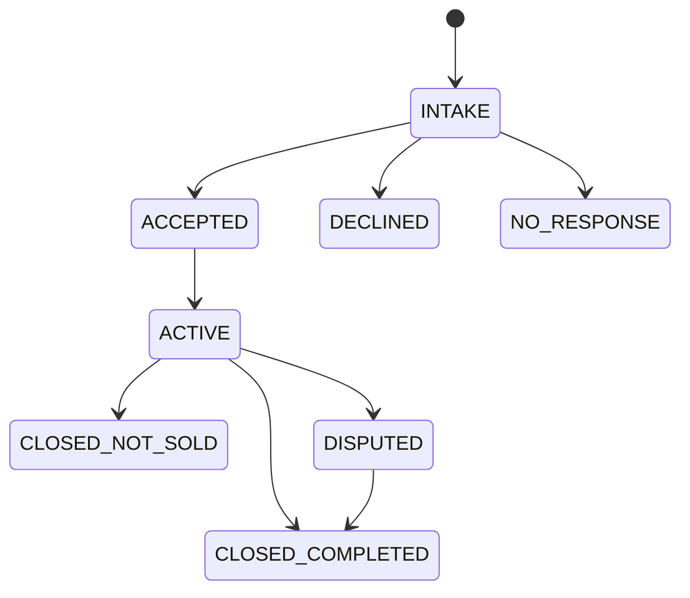

# RepairDesk — техническое задание и проектные решения

Компания «Copperline Home Repair» вымышлена; все данные, районы, цены и правила синтетические. Раздел 2 написан как ТЗ для внешнего исполнителя; остальное — контекст и обоснования.

## 1. Контекст

**Цель.** Недорогая, поддерживаемая и постепенно автоматизируемая система, которая собирает заявки на ремонт бытовой техники из нескольких источников, не теряет их, помогает одному диспетчеру, предлагает мастера и окна визита и хранит заметки, согласия, платежи и историю заказов запчастей.

**Роли.** Owner (решает спорное, меняет правила), Dispatcher (проверяет заявки, подтверждает расписание), Technician (выезжает, диагностирует, фиксирует результат с телефона), Developer (только локально).

**Источники заявок.** Форма сайта, телефонный провайдер (звонки, SMS, голосовая почта), чат, почта, повторные клиенты и рекомендации, управляющие компании, онлайн-каталоги. Приоритет подключения: нативный webhook → структурированное письмо → API → браузерная автоматизация → ручной ввод.

**Минимум для `READY_TO_SCHEDULE`.** Имя контакта, телефон, полный адрес, тип объекта (`RESIDENTIAL` / `COMMERCIAL`), тип техники, явное число единиц техники, доступность клиента. Желательно: email, бренд, модель и серийный номер, фото шильдика, описание неисправности. Модель и фото запрашиваются выборочно, только когда этого требует правило допуска или заказ запчасти.

**Расписание пилота.** 2 мастера, Monday–Friday, первый визит около 09:00, до 5 визитов в день на мастера. Окно прибытия для клиента (3 часа) хранится **отдельно** от расчётной длительности работ; диспетчер подтверждает вручную.

**Вне объёма.** Production-ингресс, реальные данные, автоотправка сообщений, автозаказ запчастей, автосписание оплаты, оптимизация маршрутов, полная ERP/CRM, хранение карточных данных.

## 2. ТЗ: каркас RepairHub v0.1

### 2.1 Задача

Построить модульный монолит, рассчитанный на дальнейшее укрепление: каркас + один полный синтетический сценарий + документированный способ расширения. Не полная CRM и не production-система.

### 2.2 Архитектура (зафиксирована)

Backend: Python, FastAPI, Pydantic. Хранение: PostgreSQL, SQLAlchemy 2.x, Alembic. Тесты: pytest, httpx, на PostgreSQL. Frontend: TypeScript, React, Vite PWA. Один репозиторий, один сервис (backend отдаёт собранный PWA). Worker в том же коде с outbox-таблицей. Локально — Docker Compose. Авторизация v0.1 — только синтетические тестовые пользователи, включаемые явным флагом; проверка прав на backend обязательна.

Плоскости: **Ingress** (приём, проверка ключа), **Logic** (детерминированные правила), **State** (PostgreSQL + аудит), **Execution** (worker/outbox), **Approval** (человек подтверждает необратимое). Зависимости: `PWA → API → application/workflow → domain/repositories → PostgreSQL`; worker идёт через outbox и application services. PWA никогда не пишет в БД и не вызывает внешние сервисы напрямую.

### 2.3 Сквозной сценарий

```text
синтетическое событие -> POST /webhooks/request_in
  -> проверка X-Intake-Webhook-Key
  -> RawInboundDelivery сохранён
  -> идентификаторы извлечены и проверены
  -> идемпотентность логического IntakeEvent
  -> RepairCase создан в фазе INTAKE + WorkItem
  -> диспетчер видит кейс в «Новых заявках», открывает карточку
  -> ставит NEEDS_INFORMATION или READY_FOR_REVIEW
  -> журнал аудита показывает все шаги
  -> повтор -> 202 duplicate_ignored, второго кейса нет
```

Маршруты: `GET /health`, `POST /webhooks/request_in`. Обязательные идентификаторы: `source_system`, `source_event_id`, `idempotency_key`. Ключ дедупликации: `(source_system, idempotency_key)` на логическом событии, не на физической доставке.

| Ситуация | Код | Тело | Что сохраняется |
| --- | --- | --- | --- |
| Нет/неверный `X-Intake-Webhook-Key` | `401` | generic | ничего; в лог только метаданные без тела |
| Верный ключ, невалидный JSON | `400` | `invalid_json` | только `RawInboundDelivery` |
| Верный ключ, нет идентификатора | `400` | `missing_identifier` + поле | только `RawInboundDelivery` |
| Новое событие | `202` | `accepted` + `case_id` | доставка, событие, кейс, задача, аудит |
| Повтор | `202` | `duplicate_ignored` + `case_id` | новая доставка со ссылкой на существующее событие |

### 2.4 Правило «кейс — одно целое»

Заявка и работа — один и тот же `RepairCase`, различается только фаза: в `INTAKE` это заявка (Request), в `ACCEPTED`/`ACTIVE` — работа (Job). Копирования и миграции между ними нет, оба представления используют один `case_id`. Один кейс может позже иметь несколько визитов, платежей и заказов запчастей.



В v0.1 реализованы `INTAKE` и просмотр `ACCEPTED`/`ACTIVE`; остальные переходы — задел.

### 2.5 Роли и права

| Действие | owner | dispatcher | technician | developer |
| --- | --- | --- | --- | --- |
| Новые заявки (очередь `INTAKE`) | ✔ | ✔ | ✘ | ✔ (local) |
| Активные работы и карточка | ✔ все | ✔ все | только назначенные | ✔ все (local) |
| Менять `intake_status` | ✔ | ✔ | ✘ | ✘ |
| Журнал аудита | ✔ | ✔ | ✘ | ✔ (local) |
| Видеть сбои worker | ✔ | ✘ | ✘ | ✔ (local) |
| Менять правила допуска | ✔ | ✘ | ✘ | ✘ |

Мастер видит только кейсы в фазе `ACCEPTED`/`ACTIVE`, назначенные ему (`assigned_technician_id`). Чужой, ещё не принятый и несуществующий кейс одинаково дают `403` (id чужих кейсов нельзя подобрать). Назначение в v0.1 задаётся только seed-данными; рабочий процесс назначения (с проверкой допусков мастера, например `GAS_CERTIFIED`) — следующий модуль.

Каждый отказ → `403` + событие `ACCESS_DENIED`. Роль определяется на сервере по заранее созданному пользователю; роль от клиента не принимается.

### 2.6 Worker

Обрабатывает безопасные внутренние команды `VERIFY_INTAKE_RECORD` и `CREATE_REVIEW_ITEM`. Не отправляет сообщения, не вызывает внешних провайдеров, не обрабатывает платежи и не заказывает запчасти. Сбой → `SystemIssue` + аудит.

### 2.7 Приёмочные сценарии (автотесты)

1. Валидный intake → `202 accepted`.
2. `RawInboundDelivery` существует раньше нормализованных записей.
3. Кейс создан в `INTAKE`.
4. Диспетчер видит очередь и карточку.
5. Диспетчер ставит `NEEDS_INFORMATION` / `READY_FOR_REVIEW`.
6. Повтор → `202 duplicate_ignored`, без второго кейса.
7. Невалидный JSON → `400`.
8. Каждый отсутствующий идентификатор → `400`.
9. Нет/неверный ключ → `401`, тело не хранится, записей нет.
10. Несанкционированный доступ к очереди отклонён и аудируется.
11. Смена статуса не той ролью отклонена и аудируется.
12. Журнал аудита доступен.
13. Команда worker выполняется и аудируется.
14. Сбой worker виден как issue/аудит.
15. Перезапуск backend не теряет закоммиченное состояние.
16. Кейс в `ACCEPTED` виден в «Активных работах» с тем же `case_id`.
17. Верный ключ + плохой payload оставляет только доставку.
18. Дубль ссылается на существующее событие и кейс.
19. Тестовая авторизация работает только в `local`/`test`, на staging/production старт падает, роль от клиента не принимается.
20. Мастер видит в «Активных работах» только назначенные ему кейсы; чужой кейс, кейс в `INTAKE` и несуществующий id дают `403`, отказ аудируется.
21. Мастеру недоступны новые заявки, журнал аудита и смена статусов.

### 2.8 Запрещено в v0.1

Реальные данные и PII; production-ингресс и креды; реальные адаптеры (телефон, Gmail, каталоги); отправка SMS/почты; движок расписания и календарь; подтверждение визитов; платежи; заказ запчастей; клиентский портал; оптимизация маршрутов; полная CRM/ERP; универсальный генератор модулей.

### 2.9 Остановись и спроси

Смена стека или формы монолита, разделение на сервисы, выбор облака, внешняя авторизация, production-ингресс, реальные данные, отправки клиентам/платежи/заказы, реализация расписания и визитов, ослабление проверки прав или аудита, расширение сценария. Молчание — не согласие: действует принятый вариант.

### 2.10 Завершение

Запуск из чистого checkout через Docker Compose; все автотесты зелёные; в репозитории нет секретов и реальных данных; сценарий показан на синтетике; есть инструкции запуска, карта прав, список событий аудита, описание worker, известные ограничения.

## 3. Модель данных

| Сущность | Назначение |
| --- | --- |
| `RawInboundDelivery` | Физическая аутентифицированная доставка: сырое тело, статус разбора |
| `IntakeEvent` | Логическое событие, уникально по `(source_system, idempotency_key)` |
| `RepairCase` | Ядро: одна история для заявки и работы; `assigned_technician_id` — назначенный мастер |
| `WorkItem` | Следующее требуемое действие персонала |
| `AuditEvent` | Неизменяемая запись действия; `case_id` может быть пустым для системных событий |
| `OutboxCommand`, `SystemIssue` | Команды worker и видимые сбои |
| `Identity` | Предсозданный тестовый пользователь с ролью |

Задел под будущие модули: `ServiceItem` (единица техники в кейсе), `Visit` (фактический визит), `Appointment` (план), `Note`/`Attachment` (оригиналы неизменяемы), `Estimate`, `PartRequirement`, `Payment` (без карточных данных), `SyncRecord` (состояние проекции отдельно от бизнес-состояния).

Перечисления: `case_phase` (см. 2.4); `intake_status`: `NEW`, `NEEDS_INFORMATION`, `READY_FOR_REVIEW`, `READY_TO_SCHEDULE`; `eligibility`: `ELIGIBLE`, `CONDITIONAL`, `OWNER_REVIEW`, `LICENSE_HOLD`, `DECLINE`, `EMERGENCY_STOP`.

События аудита: `DELIVERY_RECEIVED`, `DELIVERY_REJECTED_INVALID`, `INTAKE_EVENT_CREATED`, `DUPLICATE_IGNORED`, `CASE_CREATED`, `WORK_ITEM_CREATED`, `INTAKE_STATUS_CHANGED`, `ACCESS_DENIED`, `WORKER_COMMAND_COMPLETED`, `WORKER_COMMAND_FAILED`.

## 4. Ключевые решения и почему

| Решение | Почему |
| --- | --- |
| PostgreSQL — каноническое состояние; Google Workspace — проекция | Таблицы удобны для запуска, но не подходят как единственный надёжный слой состояния и аудита |
| Человек подтверждает сообщения, назначение, отказы, смету, заказ запчастей, спорное закрытие | Снижение финансового и репутационного риска |
| Окно прибытия клиента ≠ длительность работ | Иначе три часа окна ошибочно «съедают» ёмкость мастера |
| Готовую ERP/FSM-платформу не ставим | Избыточно для пилота и дублирует рабочее пространство |
| Google Sheets — временное хранилище только для синтетического прототипа | Дёшево проверить процесс, но без заявлений о надёжности; исключение закрывается до пилота |
| Модульный монолит, один сервис, FastAPI + PostgreSQL + React | Минимум движущихся частей; проще отдать исполнителю и расширять |
| `RepairCase` — ядро, заявка и работа — представления | Нет дублирования состояния, единая история, визиты/платежи/запчасти привязываются без копирования |
| Сначала каркас, потом (если нужно) прототип на таблицах | Не тратить время на временное решение |
| Ключ вебхука, разделение доставки и логического события, fail-closed старт | Отличает «повторную доставку» от «нового события» и не даёт включить тестовую авторизацию в бою |

## 5. Безопасность

Классы данных: Public, Internal, Confidential (имена, телефоны, адреса, заметки, фото техники), Restricted (токены, ключи, платёжные креды, документы мастеров).

Правила: Confidential и Restricted не коммитятся; карточные данные не хранятся (только provider, transaction ID, сумма, статус); внешний вебхук — HTTPS, проверка ключа, лимиты запросов (для локального запуска не требуется); worker работает под отдельной учёткой с минимумом прав; каждое внешнее действие аудируется; тестовые данные используют `555-01xx` и `example.com`; роль определяется backend, а не клиентом; тестовая авторизация выключена по умолчанию.

Главные угрозы: подделка webhook; повтор события; утечка OAuth-токена; случайное сообщение клиенту; несанкционированное изменение расписания или платежа; неверный подбор запчасти; потеря исходной заметки или фото; публичный доступ к таблицам; отправка не допущенного мастера на газовую работу.

## 6. Дорожная карта (не реализовано)

Этот раздел описывает намерения. В коде v0.1 перечисленного ниже нет: сначала задуман каркас, а модули ложатся на него без переписывания ядра.

### 6.1 Доменные правила

Правила описаны, чтобы ядро не мешало им появиться; в v0.1 не реализуются.

- **Допуск.** Результат: `ELIGIBLE`, `CONDITIONAL`, `OWNER_REVIEW`, `LICENSE_HOLD`, `DECLINE`, `EMERGENCY_STOP`. Базовый допуск не обходит более строгие гейты. Коммерческое оборудование, техника вне каталога и запросы управляющих компаний — на решение владельца. Работы с домовой проводкой, водопроводом или газовой линией — `DECLINE`.
- **Газ и стационарное подключение.** Газовая техника и техника с жёстким электроподключением получает `LICENSE_HOLD`, пока не записано подтверждение допуска мастера (`GAS_CERTIFIED` и аналоги). Предпочтение владельца гейт не снимает.
- **Аварийные сигналы.** Запах газа, дым, искрение, вода рядом с токоведущими частями → `EMERGENCY_STOP`: автоматическая обработка прекращается, владелец уведомляется, клиенту ничего автоматически не отправляется (рекомендация обратиться в аварийные службы — решение человека).
- **Плата за выезд и диагностику.** Единица 1 — `$45`, 2 — `$35`, 3 — `$25`, 4+ — `QUOTE_REQUIRED`; коммерческие объекты — от `$90` за единицу. Плата зачитывается только в ремонт той же единицы. Суммы считает детерминированный код.
- **Запчасти.** Без точной модели, серийного номера или фото шильдика и проверки совместимости заказ заблокирован (`PART_VERIFIED`). Деталь клиента — `CONDITIONAL`.
- **Согласие на сообщения.** Без подтверждённого `sms_consent_status` можно подготовить черновик, но не отправить.
- **Территория.** Основные районы вымышленного города Riverton (North Quay, Old Mill, Greenfield, Harbor Heights); Eastbrook — по расписанию; остальное — на проверку.

Проверочные сценарии для этих правил предполагается писать вместе с соответствующими модулями.

### 6.2 Этапы запуска

- **Этап 0 — основа** (готово). Репозиторий, контракты, архитектура, модель данных.
- **Этап 1 — правила** (готово). Допуск, intake, расписание, подтверждения, территория, ограничения по лицензированию — приняты как правила, не как разрешение на данные или production.
- **Этап 2 — прототип** (не закрыт). Таблицы с синтетическими данными, поток диспетчера и мастера, исходная заметка мастера хранится неизменной.
- **Этап 3 — контролируемый пилот.** Надёжное каноническое хранилище вместо таблиц, один источник заявок, все исходящие сообщения с подтверждением, проверка дублей, видимая очередь сбоев синхронизации, проверяемый аудит, тестовое резервное копирование.
- **Этап 4 — несколько источников.** Нормализация телефон/почта/сайт, маршрутизация сбоев источников на проверку, измерение дисциплины заметок мастеров, контроль расходов.
- **Этап 5 — постоянный хост.** Отдельная служебная учётка, приватное администрирование, HTTPS для вебхука, автозапуск, healthcheck и оповещения, ротация ключей.

Каркас v0.1 закрывает часть технических пунктов Этапа 3 (надёжное хранилище, проверка дублей, проверяемый аудит); остальное относится к реальному запуску.
